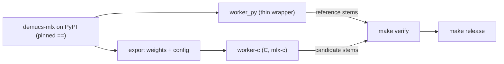

# Tracking upstream demucs-mlx

[demucs-mlx](https://github.com/ssmall256/demucs-mlx) ships often (1.4.4 -> 1.6.1 was 103
commits). We do not vendor it and we do not fork it. We **pin it exactly** and let a gate
decide whether a new version is safe.



## The two workers couple to upstream differently

| | worker-py | worker-c |
|---|---|---|
| Runs upstream code | yes (`Separator`, `apply_model`) | **no** (own C implementation on mlx-c) |
| Breaks when upstream | changes API / behavior | changes the **model contract** |
| Tracked by | exact version pin | contract manifest + parity gates |

Most upstream releases (perf, IO, hub, batching) cannot touch worker-c. Its contract is:

- exported tensor names, shapes and bytes: `models/htdemucs_6s.keys.txt`, `models/export_manifest.json`
- model config: `models/htdemucs_6s.json`
- default inference parameters (overlap, shifts, split, segment)
- the MLX version mlx-c embeds (must share major.minor with Python MLX)

## What we own vs what upstream owns

`worker_py/` owns only what the GUI needs and upstream lacks:

| Feature | Where | Upstream equivalent |
|---|---|---|
| `--progress-json` events | `worker_py/events.py`, `cli.py` | none |
| progress with default `shifts=1` | `worker_py/progress.py` (runtime shim) | none; PR in `upstream-patches/` |
| `--mp3` | `worker_py/mp3.py` | none (WAV/FLAC only) |
| `--track-name` | `worker_py/cli.py` | none |
| `DEMUCS_MLX_CACHE` -> upstream cache | `worker_py/cache.py` | `DEMUCS_MLX_CACHE_DIR` |

Everything else (batching, compile, attention precision, weights download + digest check)
is upstream's and we inherit it by bumping.

## Upgrade routine

```bash
# 1. read what changed (look at: separate/api/apply_model, model files, defaults)
open https://github.com/ssmall256/demucs-mlx/releases

# 2. bump the pin in pyproject.toml (both the dependency and the `convert` extra)
#    demucs-mlx==1.6.1  ->  demucs-mlx==X.Y.Z

# 3. one command: relock, contract check, re-record manifest, full gate
make upgrade-check

# 4. commit what changed
git add pyproject.toml uv.lock models/export_manifest.json models/htdemucs_6s.*
```

The weekly `upstream-watch` workflow does steps 2-3 for you and opens a PR (draft if the
gate fails). Merging stays manual.

### What `make verify` proves

1. `lint`: ruff + pyright on `worker_py`, `tests`, `scripts`.
2. `models-check`: re-exports the C weights from the pinned upstream and fails if tensor
   names/shapes, config or weight bytes differ from what is committed (**drift**).
3. `worker-c` build + `worker-c-test`: kernel, STFT, OLA unit tests and numeric compare
   against the committed goldens, with thresholds.
4. frozen worker build (`dist/worker-py`).
5. `pytest tests`:
   - py worker event stream matches the GUI contract (order, fields, stdout is JSON only)
   - progress reaches 100% (also with `shifts>1`), mp3 output, error event + exit code
   - **py vs c**: max abs diff and per-stem SI-SDR on a fixed clip
   - **py vs frozen**: near-identical
   - C worker defaults equal upstream's defaults; mlx-c / mlx pairing; pin is exact
   - progress shim still works against the installed upstream

## When the gate fails

| Symptom | Meaning | Action |
|---|---|---|
| `models-check`: tensor names/shapes changed | upstream changed the layout (fusion, renames) | update `worker-c/src/weights.c` / loaders, re-export (`make models-export`), re-run |
| `models-check`: weight bytes changed | upstream retrained or re-converted | usually fine; confirm parity gates pass, commit the manifest |
| `models-check`: config changed | architecture kwargs changed | update `worker-c` config parsing and `htdemucs.c`; re-export goldens (`make goldens`) |
| `test_c_matches_py` fails | numerics drifted between py and c | find which stem; compare `test_compare` intermediates; check attention precision default (fp16 vs fp32) |
| `test_c_worker_defaults_match_upstream` | upstream changed overlap/shifts/split defaults | change `main.c` defaults deliberately or pass explicit flags from the GUI |
| `test_mlx_c_tag_matches_manifest_and_mlx_minor` | Python MLX moved to a new minor | bump the mlx-c tag in `worker-c/CMakeLists.txt` to one embedding that minor |
| `test_progress_shim` fails | upstream changed progress plumbing | fix `worker_py/progress.py`, or adopt the native callback if upstream shipped one |
| event-stream tests fail | `worker_py` broke the GUI contract | fix `worker_py`; the GUI (`demucs-ui-app`) parses these lines |

Baseline thresholds live in `tests/test_parity.py` with the measured numbers next to them.
If a bump legitimately moves them, change them in the same PR and say why.

## Weights

Upstream publishes weights on Hugging Face and verifies a SHA-256 baked into the package.
The worker downloads on first use, or you can bundle them:

```bash
make models-fetch     # -> models/mlx-cache/htdemucs_6s.{safetensors,_config.json}
```

The C worker reads a different export of the same tensors (`models/htdemucs_6s.safetensors`,
no `model_0.` key prefix, plus `htdemucs_6s.json`). Both use the filename
`htdemucs_6s.safetensors`, so they must live in different directories. `worker_py` guards
this: if `DEMUCS_MLX_CACHE` points at a directory holding a C export, it uses a `mlx/`
subdirectory instead of overwriting it. Releases publish the C export as
`htdemucs_6s.c.safetensors` plus `htdemucs_6s.json` so the two files do not collide.

## Upstreaming

`upstream-patches/` holds changes we want upstream so the shim can go away. See its README.
